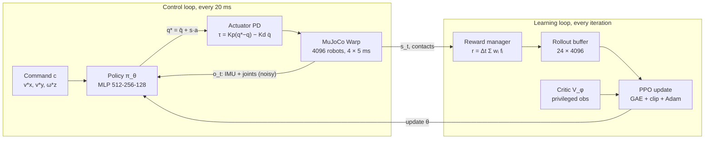

# Reinforcement learning for bipedal locomotion: the velocity task

Lecture notes for the EIR course. Each section answers one question of the lecture and points to the example you can run for it.

| Section | Question | Run it |
| --- | --- | --- |
| 0 | What is the velocity task, as an RL problem? | all examples |
| 1 | Why not a PID controller or a model-based trajectory generator (LIPM/ZMP)? | example1 → example10 |
| 2 | What are tabular methods (Q-learning), and why not use them here? | **example1, example2** |
| 3 | How is the reward designed, and how does it relate to an MDP? | example3 → example10 |
| 4 | Policy-based vs value-based methods | example1/2 (value-based) vs example3+ (actor-critic) |
| 5 | The neural network: architecture, updates, recommended features | example3 → example10 |
| 6 | Why MuJoCo, compared to Matlab, Gazebo, Webots and Isaac Sim? | — |
| 7 | mjlab vs Isaac Lab | — |
| 8 | The reward in detail: every term, its formula and where its values come from | **example3 → example10** |

The notes describe mjlab's generic velocity configuration (`make_velocity_env_cfg`, mjlab 1.6.0, rsl_rl 5.4.2). Generic numbers use the Unitree G1 (29 joints), mjlab's reference robot. Where the course's Booster K1 differs, the K1 value is given too.

---

## 0. The velocity task as an RL problem

The policy learns to follow a random velocity command (v_x, v_y, ω_z), expressed in the robot's body frame. Every 20 ms it reads proprioceptive observations and outputs joint position offsets. A low-level PD controller turns them into torques, while MuJoCo Warp simulates thousands of robots in parallel on the GPU at 200 Hz.

| Parameter | Value | Where |
| --- | --- | --- |
| Physics step | 0.005 s (200 Hz), solver with 10 iterations | `SimulationCfg.mujoco.timestep` |
| Decimation → control step | 4 → 0.02 s (50 Hz) | `decimation=4` |
| Episode length | 20 s = 1000 control steps | `episode_length_s` |
| Command ranges | mjlab: v_x, v_y ∈ [−1, 1] m/s, ω_z ∈ [−0.5, 0.5] rad/s, widened by a curriculum. Course K1: fixed v_x ∈ [−1, 1], v_y ∈ [−0.5, 0.5] m/s, ω_z ∈ [−1.2, 1.2] rad/s | `UniformVelocityCommandCfg.ranges` |
| Command resampling | every 3–8 s; 10 % of envs stand still, 30 % use heading control, 20 % only walk forward | `resampling_time_range`, `rel_*_envs` |
| Action | q* = q̄ + s · a (an offset on the default pose) | `JointPositionActionCfg(use_default_offset=True)` |
| Parallel environments | 4096 (PPO) | queue / CLI |
| Data per PPO iteration | 24 steps × 4096 envs = 98 304 transitions | `num_steps_per_env=24` |



At deployment only the top loop remains, using the mean action μ_θ(o). The reward, the buffer, the critic and PPO exist only during training.

---

## 1. Why not a PID controller or a model-based trajectory generator (LIPM/ZMP)?

A PID solves tracking for one joint, not the problem of walking. The LIPM does solve balance, but only under assumptions that a real biped breaks in exactly the interesting cases: pushes, rough terrain, unexpected contacts. RL learns the whole control law directly on the multibody dynamics with contacts, and makes it robust through domain randomization.

### What each approach does (and does not do)

| Criterion | Per-joint PID | LIPM + ZMP (preview control / MPC) | RL (this task) |
| --- | --- | --- | --- |
| What it decides | Torque to track a given q* | CoM trajectory and footsteps that satisfy the ZMP criterion | The whole law obs → q* at 50 Hz |
| Model needed | None (but something must generate q*) | Simplified model + inverse kinematics + state estimator | A simulator; no model at run time |
| Balance and footsteps | Absent: must be designed on top | Explicit, with guarantees inside the model | Emerge from optimizing the reward |
| Hybrid contacts, impacts, slipping | Not considered | Outside the model; corrected by compensation layers | In the simulator, and randomized |
| Rough terrain, pushes | Fragile | Needs replanning and perception | Terrain curriculum + pushes during training |
| Tuning | Gains per joint | Many hand-set parameters (heights, timings, MPC weights) | Reward weights + hyperparameters |
| Guarantees / interpretability | High at joint level | High inside the model | Low: empirical validation |

The PID is not thrown away: the PD stays in the inner loop. The policy outputs q* = q̄ + s · a, and the actuator applies τ = K_p (q* − q) − K_d q̇ at 200 Hz. RL replaces the *decision* layer, not the servo layer. example1 and example2 make this concrete: the Furuta pendulum's arm is driven by exactly this kind of position servo (the K1 knee motor), and the learner only chooses targets.

### The LIPM assumptions

The LIPM ([Kajita et al., IROS 2001](https://unit.aist.go.jp/jrl-22022/assets/bib/kajita_iros_2001.bib)) reduces the robot to a point mass at constant height z_c on a massless leg:

```math
\ddot{x}_c = \frac{g}{z_c}\,(x_c - p_x), \qquad \ddot{y}_c = \frac{g}{z_c}\,(y_c - p_y)
```

(x_c, y_c) is the CoM and (p_x, p_y) the ZMP, which must stay inside the support polygon ([Vukobratović and Borovac, 2004](https://doi.org/10.1142/S0219843604000083)). *Preview control* ([Kajita et al., ICRA 2003](https://people.csail.mit.edu/katiebyl/kb/DW2008/papers_of_tangential_interest/kajita03.pdf)) plans the CoM from a future ZMP reference. The *capture point* ([Pratt et al., Humanoids 2006](https://cs.utexas.edu/~shivaram/readings/b2hd-PrattCDG2006.html)) decides where to step to come to a stop. What the model leaves out:

- **Constant CoM height and angular momentum ≈ 0.** That rules out arm swing, trunk rotation, and using angular momentum to recover. The mjlab reward *regulates* angular momentum (`angular_momentum`) instead of assuming it is zero.
- **Massless legs and a flat foot in firm contact.** Impacts, slipping, partial foot contact and varying friction (0.3–1.2 in mjlab's randomization) are left out.
- **Hybrid dynamics.** Single and double support change the system. The model takes the transition as given instead of optimizing it.
- **Underactuation.** The floating base (6 DoF) has no actuators. It is controlled only through contact forces, which can only push.
- **A chain of dependencies.** Closing the loop needs inverse kinematics, ankle force/admittance control and a state estimator (base velocity, contacts). Each layer adds assumptions and parameters.

### Why RL here

- **The objective is written directly.** "Follow (v_x, v_y, ω_z) without falling" becomes the reward as is (section 8); no intermediate trajectory is hand-designed.
- **Robust by construction.** The base configuration perturbs the robot during training: pushes every 1–3 s, random friction, ±0.015 rad encoder bias, CoM offsets, noise on every observation, and a terrain curriculum. The policy learns one law that works across that whole distribution (example10).
- **Empirical evidence.** [Rudin et al. (CoRL 2021)](https://proceedings.mlr.press/v164/rudin22a.html) train locomotion in minutes with thousands of GPU robots. [Siekmann et al. (RSS 2021)](https://roboticsproceedings.org/rss17/p061.html) climb stairs blind with Cassie. [Radosavovic et al. (Science Robotics 2024)](https://arxiv.org/abs/2303.03381v2) take a humanoid outdoors with zero-shot sim-to-real.
- **Cheap on the robot.** An MLP of ~2–3 × 10⁵ parameters (section 5) evaluates in microseconds, with no online optimization as in MPC.

### Honest trade-offs

- No formal stability guarantees: validation is empirical (sim2sim, then hardware).
- The sim-to-real gap depends on actuator fidelity and randomization.
- *Reward engineering*: 14 interacting weighted terms (section 8; example3–example9 add them two at a time).
- Model-based methods still win when planned footstep precision or hard constraints matter, which is why RL + MPC hybrids exist.

---

## 2. Tabular methods (Q-learning) and why they do not scale here

Tabular Q-learning has to enumerate states and actions. The velocity task has ~70–100 continuous state dimensions and 20–29 continuous actions. Discretizing the actions alone already gives 10⁸–10²⁰ actions per state, so the task uses function approximation and a continuous policy (actor-critic) instead. **example1 and example2 let you feel this limit on a much smaller robot.**

### What Q-learning does

Q-learning ([Watkins and Dayan, 1992](https://doi.org/10.1007/BF00992698)) stores a table Q(s, a) and updates it after every transition:

```math
Q(s_t,a_t) \leftarrow Q(s_t,a_t) + \alpha\Big[r_t + \gamma \max_{a'} Q(s_{t+1},a') - Q(s_t,a_t)\Big]
```

The policy is greedy: π(s) = argmax_a Q(s, a). It converges to the optimum if every (s, a) pair is visited infinitely often. That is the catch: every cell has to be **visited and stored**, and every step **maximizes** over all actions. The code is in `src/eir_course/tasks/furuta/runner.py`: a runner that plugs into mjlab's `train` and `play` in place of PPO, so the Furuta examples are mjlab tasks like the K1 ones.

### The Furuta pendulum examples

Both examples discretize the state (α, α̇, θ, θ̇) into bins and use 7 discrete arm position targets. The arm motor is the K1 knee motor (the same actuator config) and the action scale follows the K1 rule s = 0.25 · τ_max / K_p. 256 pendulums run in parallel and update one shared table.

| | example1: balance | example2: swing-up + balance |
| --- | --- | --- |
| Start | within ±15° of upright | hanging down, at rest |
| Q-table | 9 × 9 × 5 × 5 = 2025 states × 7 actions = 14 175 entries | 21 × 15 × 7 × 7 = 15 435 states × 7 actions = 108 045 entries |
| Default training | 300 iterations (1.8 M transitions) | 3000 iterations (18.4 M transitions) |

Going from balance to swing-up only widens the region of state space the agent must cover, yet the table grows 7.6×, and the agent needs far more experience to visit it. Try `uv run train example1 --agent.bins 15,15,9,9` to watch the table explode, and follow `q_table/visited_fraction` in W&B.

### Discretizing the action of a humanoid

The action of the velocity task is a vector a ∈ ℝ^N, one offset per joint. With b levels per joint there are b^N joint actions:

| Joints (N) | 3 levels | 5 levels | 11 levels |
| --- | --- | --- | --- |
| 12 (legs only) | 5.3 × 10⁵ | 2.4 × 10⁸ | 3.1 × 10¹² |
| 20 (K1, legs + arms) | 3.5 × 10⁹ | 9.5 × 10¹³ | 6.7 × 10²⁰ |
| 29 (G1, full body) | 6.9 × 10¹³ | 1.9 × 10²⁰ | 1.6 × 10³⁰ |

With 12 joints and only 5 levels, a single row of the table (one state) takes ~1 GB in float32, and the `max` in the Bellman update evaluates 2.4 × 10⁸ actions at every control step. Discretization also creates a dilemma with no way out:

- **Few levels → coarse control.** Jumps between levels cause *chattering*, torque spikes and actuator wear, trigger the `action_rate_l2` penalty (section 8), and lose the fine precision balance needs.
- **Many levels → combinatorial explosion.** Resolution grows linearly but the table grows exponentially in N.
- **Structure is lost.** To a table, "0.10 rad" and "0.11 rad" are unrelated actions; what is learned for one does not transfer to the other.

### The state does not fit either

The K1 actor observation has 69 dimensions. With 10 levels per dimension that is 10⁶⁹ states. A full G1 training run in mjlab (30 000 iterations × 24 steps × 4096 envs) sees ~3 × 10⁹ transitions in total, so the fraction of visited cells is effectively zero. Without generalization between neighbouring states, tabular Q-learning learns nothing useful.

### How deep RL solves it (and honest nuances)

- **Continuous state.** A neural network approximates Q or π and generalizes between similar states, as in DQN ([Mnih et al., Nature 2015](https://doi.org/10.1038/nature14236)). That solves the state side, but DQN still needs an argmax over a discrete action set.
- **Continuous action.** An actor π_θ(s) *learns* the argmax instead of searching for it, as in DDPG, SAC or PPO. This is what the K1 examples do (section 4). NAF ([Gu et al., ICML 2016](https://proceedings.mlr.press/v48/gu16.html)) takes another route: a Q that is quadratic in a, with an analytic maximum.
- **Factorized discretization.** This does work: one output head per action dimension makes the cost linear in N instead of exponential. See BDQ ([Tavakoli et al., AAAI 2018](https://ojs.aaai.org/index.php/AAAI/article/view/11798)) and DecQN ([Seyde et al., ICLR 2023](https://mlanthology.org/iclr/2023/seyde2023iclr-solving)). [Seyde et al. (NeurIPS 2021)](https://mlanthology.org/neurips/2021/seyde2021neurips-bangbang) even show bang-bang policies competing on benchmarks. None of these is tabular, though, and extreme actions are undesirable on real hardware.

**One-liner:** the problem is not Q-learning itself, it is the *table*. With N joints, every extra level of resolution multiplies the number of actions by ((b+1)/b)^N.

---

## 3. Reward design and its relation to an MDP

The reward is a weighted sum of two kinds of terms. *Task* terms are positive and bounded in [0, 1]: follow the command, stay upright, keep a natural pose. *Regularizers* penalize costly or dangerous motion. Formally the problem is written as an MDP; in practice it is a contextual, non-stationary POMDP with a *shaped* reward.

### Design principles

- **Tracking with an exponential kernel.** Task terms have the form exp(−e²/σ²): bounded in [0, 1], smooth, and always informative. An error e = σ gives e⁻¹ ≈ 0.37, so σ reads as the term's *tolerance*.
- **Quadratic or linear penalties for what we do not want:** action jumps, joint limits, foot slip, impacts, trunk wobble.
- **Gating by the command.** Footstep terms only switch on when ‖v*_xy‖ + |ω*_z| exceeds a threshold; otherwise the robot would learn to walk in place when asked to stand.
- **Scaling by Δt.** The per-step reward is r_t = Σ w_i · f_i · Δt with Δt = 0.02 s (`reward_manager.py`), so the weights do not depend on the control rate.
- **No explicit alive bonus.** Task terms add up to at most (2 + 2 + 1 + 1) · 0.02 = 0.12 per step, so falling forfeits all future reward: termination acts as an implicit penalty. The Furuta swing-up reward (example2) is kept non-negative for the same reason. With a negative reward, ending the episode early would pay off.

### The formal MDP, mapped to the code

| MDP element | Definition | In mjlab |
| --- | --- | --- |
| State S | The full system state | MuJoCo qpos, qvel + command + terrain + randomized parameters |
| Observation O | What the agent sees | `actor` group (noisy) and `critic` group (privileged, clean) |
| Action A | a_t ∈ ℝ^N | Offsets q* = q̄ + s · a for the PD (`JointPositionActionCfg`) |
| Transition P(s′ \| s, a) | Dynamics | MuJoCo Warp, 4 sub-steps of 5 ms per action + events (pushes) |
| Reward r(s, a) | One scalar per step | `RewardManager`: weighted terms × Δt |
| Discount γ | Weight of the future | 0.99 → effective horizon 1/(1−γ) = 100 steps ≈ 2 s |
| Terminal states | End of the episode | `fell_over` (tilt > 70°; K1: stochastic, 63°), `illegal_contact` (K1) |
| Truncation | Artificial cut | `time_out` (20 s) and `out_of_terrain_bounds`, marked `time_out=True` |
| Initial distribution ρ₀ | Reset distribution | Random pose and yaw, joint offsets |

### How it differs from the textbook MDP

1. **It is a POMDP.** To be deployable, the actor sees neither the true linear velocity nor the terrain, and its observations carry uniform noise: ±0.2 rad/s on the gyro, ±1.5 rad/s on joint velocities, ±0.01 rad on positions, plus a fixed encoder bias. The critic gets privileged information (contacts, forces, foot heights, unbiased positions). This is *asymmetric actor-critic* ([Pinto et al., RSS 2018](https://roboticsproceedings.org/rss14/p08.html)): the critic is only used in training, so it may "cheat".
2. **It is a contextual MDP.** The command c = (v*_x, v*_y, ω*_z) defines a different task in every episode; the policy is π(a | o, c) and the reward depends on c ([Hallak et al., 2015](https://arxiv.org/abs/1502.02259)). The command also changes within the episode (every 3–8 s), and heading is closed with a P controller (k = 0.5).
3. **Some reward pieces are not Markovian in the observation.** `action_rate_l2` depends on a_{t−1}, `air_time` on an air-time counter, and `foot_swing_height` stores the foot's peak height since lift-off. They are made Markovian either by putting the variable in the observation (the last action) or by giving it to the critic (air time, contacts).
4. **Truncation ≠ termination.** A *time-out* is not a terminal state. rsl_rl *bootstraps* it: r ← r + γ V(s) at the cut step (`rsl_rl/algorithms/ppo.py`), as recommended by [Pardo et al. (ICML 2018)](https://proceedings.mlr.press/v80/pardo18a.html). A fall is terminal and ends the return. The Furuta Q-learning runner makes the same distinction: a terminal target is `r`, a time-out target is `r + γ max_a Q(s, a)`, bootstrapped from the current state like PPO because mjlab has already reset the episode.
5. **The reward is shaped, and that changes the optimum.** [Ng, Harada and Russell (ICML 1999)](https://mlanthology.org/icml/1999/ng1999icml-policy/) show that only potential-based shaping, F = γΦ(s′) − Φ(s), preserves the optimal policy. mjlab's terms are not of that form: they are deliberate preferences (smooth gait, feet up, soft impacts), not just learning aids, which is why the weights matter. example3 → example9 show the effect of each pair.
6. **It is non-stationary.** The command curriculum widens the velocity ranges (the course fixes them instead) and the terrain curriculum raises difficulty, so P and the context distribution change during training. Domain randomization (friction, CoM, gains) makes each environment a slightly different MDP: strictly, the expected return is optimized over a *family* of MDPs (example10).
7. **Short horizon, long episode.** With γ = 0.99 the policy "looks" ~2 s ahead even though the episode lasts 20 s. That is enough for a step or two of implicit planning, and keeps the estimator's variance low.

---

## 4. Policy-based vs value-based

For continuous locomotion with thousands of GPU environments, a purely value-based method is ruled out: it needs an argmax over actions, which is exactly what this action space makes impossible (section 2). Pure policy gradient has too much variance. The K1 examples use **actor-critic** PPO, which combines an explicit policy with a critic that estimates value. The Furuta examples are the value-based counterpoint: there the action set is tiny (7 targets), so the argmax is trivial.

### The two families in one line each

- **Value-based:** learn Q(s, a) with the Bellman equation; the policy is implicit, π(s) = argmax_a Q(s, a). Examples: Q-learning (example1/2), DQN ([Mnih et al., 2015](https://doi.org/10.1038/nature14236)).
- **Policy-based:** parameterize π_θ(a|s) and climb the gradient of the expected return, ∇_θ J = E[∇_θ log π_θ(a|s) · Â]. Example: REINFORCE ([Williams, 1992](https://doi.org/10.1007/BF00992696)).
- **Actor-critic:** the actor is policy-based and the critic value-based. The critic exists only to give  low variance (PPO) or to be maximized by the actor (SAC).

### Trade-offs

| Criterion | Pure value-based (Q-learning / DQN) | Pure policy-based (REINFORCE) | On-policy actor-critic (PPO, used here) | Off-policy actor-critic (SAC / FlashSAC) |
| --- | --- | --- | --- | --- |
| What is learned | Q(s, a) | π_θ(a\|s) | π_θ(a\|s) + V_φ(s) | π_θ(a\|s) + two Q_φ(s, a) |
| Continuous actions | No: needs discretization; argmax exponential in N | Yes | Yes: diagonal Gaussian | Yes: tanh-squashed Gaussian in [−1, 1] |
| How the action is chosen | argmax search at every step | Direct sampling | Direct sampling; the mean at deployment | The actor learns to maximize Q − α log π |
| Sample efficiency | Medium-high (replay) | Very low | Low-medium: each batch is used 5 epochs, then discarded | High: replay of 10⁶, n-step returns |
| Data reuse | Off-policy | None | Only the current rollout (98 304 transitions) | The whole buffer, from old policies |
| Stability / variance | Bootstrapping bias; *deadly triad* (FA + bootstrapping + off-policy) | Unbiased but very high variance | High: clipped ratio (ε = 0.2), KL-adaptive LR, GAE (λ = 0.95) | More fragile: Q overestimation, mitigated with twin critics, soft targets and bounded norms |
| Exploration | ε-greedy | Policy noise | Learned σ + entropy bonus (0.01) | Maximum entropy with auto-tuned temperature α |
| Stochastic policy | No (greedy, deterministic) | Yes | Yes | Yes |
| Fit with 4096 GPU envs | Not applicable | Parallelizes, but wastes data | Excellent: more envs, better gradient; minutes to hours | Good with ~1024 envs; gradient updates are the bottleneck |
| Hyperparameter sensitivity | High | High (LR) | Low: legged_gym defaults work across robots | Medium-high: target temperature, update ratio, τ |
| Action smoothness on hardware | Discrete jumps | Noisy | Smooth Gaussian mean + `action_rate_l2` | Bounded by tanh; high entropy can give aggressive actions |
| Use in legged locomotion | Almost none | Historical | De facto standard (legged_gym, Isaac Lab, mjlab) | Emerging: FastTD3 on Booster T1, FlashSAC |
| Verdict for this task | Infeasible (fine for the Furuta toy) | Infeasible: variance | Default choice: robust, cheap to tune | Alternative when sample efficiency matters |

### How each choice affects the velocity task

- **PPO exploits cheap simulation.** With MuJoCo Warp, an iteration of 98 304 transitions is cheap, so PPO's sample inefficiency is offset by parallelism. Clipping and the adaptive LR make it predictable; the same hyperparameters work for G1, T1 and K1. See [Schulman et al., 2017](https://arxiv.org/abs/1707.06347) (PPO) and [2016](https://arxiv.org/abs/1506.02438) (GAE).
- **Off-policy makes every transition count.** A Q critic that reuses old data learns from far fewer interactions; the risk is bootstrapping instability with large networks. SAC ([Haarnoja et al., 2018](https://arxiv.org/abs/1801.01290)) adds maximum entropy, TD3 ([Fujimoto et al., 2018](https://arxiv.org/abs/1802.09477)) twin critics, FlashSAC ([2026](https://arxiv.org/abs/2604.04539)) and SimbaV2 ([Lee et al., ICML 2025](https://proceedings.mlr.press/v267/lee25u.html)) bounded weight and feature norms. [FastTD3 (Seo et al., 2025)](https://arxiv.org/abs/2505.22642) deployed an off-policy policy on a real Booster T1.
- **Exploration shapes the gait.** PPO shrinks σ gradually; SAC keeps entropy high by design, which explores more but can produce harsher actions, so smoothness penalties matter more off-policy.
- **The privileged critic works for both**, precisely because they are actor-critic: a pure value-based method cannot separate "who judges" from "who acts".

---

## 5. The neural network in depth

The policy is small: a multilayer perceptron (MLP) with 3 hidden layers (512 → 256 → 128) and ELU activations. For the course's K1 the actor has 202 644 parameters plus 20 standard deviations; for G1 on rough terrain it has 314 909 plus 29. The critic has the same shape with a different input and a scalar output. Both train together with PPO and a single Adam optimizer. The configuration is in `src/eir_course/tasks/velocity/config/k1/rl_cfg.py` and matches mjlab's upstream G1 task.

### 5.1 Inputs and outputs

Actor and critic read different observation groups (*asymmetric actor-critic*). Sizes for the course's K1 (20 joints: legs + arms, no head):

| Term | Dim. | Noise (uniform) | Actor | Critic | Notes |
| --- | --- | --- | --- | --- | --- |
| `base_lin_vel` | 3 | — | No | Yes | Simulator velocimeter: no real sensor measures it, so only the critic sees it |
| `base_ang_vel` | 3 | ±0.2 rad/s | Yes | Yes | IMU gyroscope |
| `projected_gravity` | 3 | ±0.05 | Yes | Yes | Gravity in the body frame: encodes roll and pitch |
| `joint_pos` | 20 | ±0.01 rad | With encoder bias | Unbiased | Relative to the default pose q̄ |
| `joint_vel` | 20 | ±1.5 rad/s | Yes | Yes | |
| `actions` | 20 | — | Yes | Yes | Last action: makes `action_rate_l2` Markovian |
| `command` | 3 | — | Yes | Yes | (v*_x, v*_y, ω*_z) |
| `height_scan` | 187 | — | No | Yes (rough) | 17 × 11 ray grid (1.6 × 1.0 m, 0.1 m), scaled by 1/5 |
| `foot_height` | 2 | — | No | Yes | Height of each foot above the terrain |
| `foot_air_time` | 2 | — | No | Yes | |
| `foot_contact` | 2 | — | No | Yes | Binary |
| `foot_contact_forces` | 6 | — | No | Yes | sign(F) · log(1 + \|F\|) |

Totals: the **actor** reads 69 values (`3 + 3 + 20 + 20 + 20 + 3`); the **critic** reads 271 on rough terrain (example10) and 84 on flat ground (example3–9). The actor outputs 20 action means plus a vector of 20 standard deviations that does *not* depend on the input; the critic outputs a scalar V(s). (mjlab's generic G1 config also gives the actor `base_lin_vel` and the height scan: 286 inputs on rough terrain.)

### 5.2 The layers

`rsl_rl.modules.MLP` is an `nn.Sequential`: Linear → ELU for each hidden layer and a final Linear with no activation. K1 actor:

| Layer | Shape | Parameters (W + b) | Activation |
| --- | --- | --- | --- |
| 1 | 69 → 512 | 35 840 | ELU |
| 2 | 512 → 256 | 131 328 | ELU |
| 3 | 256 → 128 | 32 896 | ELU |
| Output | 128 → 20 | 2 580 | Identity (means μ) |
| σ | 20 | 20 | — |
| **Actor total** | | **202 664** | |

- **ELU** ([Clevert et al., ICLR 2016](https://arxiv.org/abs/1511.07289)):

```math
\mathrm{ELU}(x) = \begin{cases} x & x > 0 \\ \alpha\,(e^{x}-1) & x \le 0 \end{cases}, \qquad \alpha = 1
```

- **Why ELU rather than ReLU.** It is smooth (C¹), so the policy is a smooth function of the observation, which suits control. Its gradient is non-zero for x < 0, avoiding "dead" neurons over a long, non-stationary training run. Its outputs have mean close to zero.
- **Funnel shape (512 → 256 → 128).** The wide first layer absorbs heterogeneous inputs (IMU, joints, terrain); the following layers compress them into a compact representation the action is read from.
- **Initialization.** `MLPModel` does not call `MLP.init_weights`, so PyTorch's default `nn.Linear` initialization is used: Kaiming-uniform, W, b ~ U(−1/√fan_in, 1/√fan_in).
- **Cost.** One inference is ~2 × 10⁵ multiply-adds. At 50 Hz that is trivial for an embedded CPU, with no online optimization.

### 5.3 Observation normalization

With `obs_normalization=True`, the input goes through `EmpiricalNormalization` before the first layer, because its magnitudes differ wildly (rad/s, rad, metres, a unit gravity vector):

```math
\hat{x} = \frac{x - \mu}{\sigma + 0.01}
```

The statistics are *buffers*, not trainable parameters. They update at every environment step with an incremental batch merge, for a batch of B observations with mean μ_B and variance σ²_B:

```math
n \leftarrow n + B,\quad \rho = \frac{B}{n},\quad \delta = \mu_B - \mu,\quad \mu \leftarrow \mu + \rho\,\delta,\quad \sigma^2 \leftarrow \sigma^2 + \rho\big(\sigma^2_B - \sigma^2 + \delta\,(\mu_B - \mu)\big)
```

Actor and critic have separate normalizers. The actor's is exported with the network to ONNX, so the robot does not need to reimplement it.

### 5.4 The stochastic head

The actor defines a diagonal Gaussian whose mean comes from the network and whose standard deviation is a global `nn.Parameter` (`std_type="scalar"`), initialized to 1.0 and clamped to [10⁻⁶, 10⁶]:

```math
\pi_\theta(a\mid o) = \mathcal{N}\big(\mu_\theta(o),\ \mathrm{diag}(\sigma^2)\big), \qquad \log \pi_\theta(a\mid o) = -\sum_{j=1}^{N}\Big[\frac{(a_j-\mu_j)^2}{2\sigma_j^2} + \log\sigma_j + \tfrac{1}{2}\log 2\pi\Big]
```

```math
\mathcal{H}(\pi) = \sum_{j=1}^{N}\Big(\tfrac{1}{2}\log(2\pi e) + \log\sigma_j\Big)
```

The entropy depends only on σ, not on the state, so PPO's entropy bonus directly stops σ from collapsing too early, while learning shrinks it over time. Training samples a ~ π; deployment uses the mean a = μ_θ(o), so the robot runs a deterministic function.

### 5.5 How the weights are updated: PPO step by step

Each PPO iteration collects data with the current policy, takes 20 gradient steps on it, and throws it away (`rsl_rl/algorithms/ppo.py`).

1. **Rollout.** 4096 envs × 24 steps = 98 304 transitions. Each step stores o_t, a_t ~ π_old, log π_old(a_t|o_t), V_old(s_t) and the Gaussian's (μ, σ); updates the normalizers; and bootstraps time-outs: r_t ← r_t + γ V(s_t).
2. **Advantages with GAE** ([Schulman et al., ICLR 2016](https://arxiv.org/abs/1506.02438)), walking the rollout backwards, with d_t = 1 at a termination:

```math
\delta_t = r_t + \gamma(1-d_t)V(s_{t+1}) - V(s_t), \qquad \hat{A}_t = \delta_t + \gamma\lambda(1-d_t)\hat{A}_{t+1}, \qquad R_t = \hat{A}_t + V(s_t)
```

   with γ = 0.99 and λ = 0.95. Â is then standardized over the 98 304 samples. λ trades bias for variance: λ = 0 is TD(0) (little noise, much bias), λ = 1 is Monte Carlo (unbiased, very noisy).
3. **Mini-batches.** 5 epochs × 4 mini-batches of 24 576 samples = 20 gradient steps per iteration.
4. **Loss.** With ρ_t = exp(log π_θ(a_t|o_t) − log π_old(a_t|o_t)) and ε = 0.2 ([Schulman et al., 2017](https://arxiv.org/abs/1707.06347)):

```math
L^{\text{clip}} = -\,\mathbb{E}_t\Big[\min\big(\rho_t \hat{A}_t,\ \mathrm{clip}(\rho_t, 1-\varepsilon, 1+\varepsilon)\,\hat{A}_t\big)\Big]
```

```math
L^{V} = \mathbb{E}_t\Big[\max\big((V_\phi(s_t)-R_t)^2,\ (V_{\text{old}}(s_t) + \mathrm{clip}(V_\phi(s_t)-V_{\text{old}}(s_t), -\varepsilon, \varepsilon) - R_t)^2\big)\Big]
```

```math
L = L^{\text{clip}} + 1.0\cdot L^{V} - 0.01\cdot \mathcal{H}(\pi_\theta)
```

   The clip stops a single update from moving an action's probability too far: a cheap trust region. The value clip avoids large jumps in V.
5. **Backpropagation.** One `loss.backward()` computes gradients for θ (actor and σ) and φ (critic). The networks share no layers, so each only receives its own loss term.
6. **Gradient clipping.** `clip_grad_norm_(·, 1.0)` separately on actor and critic: if ‖g‖ > 1 then g ← g / ‖g‖.
7. **Adam step** ([Kingma and Ba, ICLR 2015](https://arxiv.org/abs/1412.6980)), one optimizer over both networks, PyTorch defaults β₁ = 0.9, β₂ = 0.999, ϵ = 10⁻⁸:

```math
m \leftarrow \beta_1 m + (1-\beta_1)g, \quad v \leftarrow \beta_2 v + (1-\beta_2)g^2, \quad \theta \leftarrow \theta - \eta\,\frac{m/(1-\beta_1^k)}{\sqrt{v/(1-\beta_2^k)} + \epsilon}
```

8. **Adaptive learning rate.** Every mini-batch computes the mean KL between the old and new Gaussians:

```math
\mathrm{KL} = \sum_j \Big[\log\frac{\sigma_j^{\text{new}}}{\sigma_j^{\text{old}}} + \frac{(\sigma_j^{\text{old}})^2 + (\mu_j^{\text{old}}-\mu_j^{\text{new}})^2}{2(\sigma_j^{\text{new}})^2} - \tfrac{1}{2}\Big]
```

   If KL > 2 · 0.01 then η ← max(10⁻⁵, η / 1.5); if KL < 0.01 / 2 then η ← min(10⁻², η · 1.5). It starts at 10⁻³. This keeps each update near a "safe" step size without hand-tuning the LR.

```text
for iteration in range(max_iterations):          # example3-10: 10 000
    for t in range(24):                          # rollout, 4096 envs in parallel
        a ~ N(mu_theta(norm(o)), sigma);  v = V_phi(norm(o_critic))
        o, r, done = env.step(a)                 # 4 x 5 ms of physics + reward x dt
        update_normalizers(o); bootstrap_timeouts(r, v)
    A, R = gae(r, v, done, gamma=0.99, lam=0.95); A = standardize(A)
    for epoch in range(5):
        for batch in split(data, 4):             # 24 576 samples
            loss = L_clip + 1.0 * L_V - 0.01 * H
            adapt_lr_by_kl(target=0.01)
            loss.backward(); clip_grad_norm(actor, 1.0); clip_grad_norm(critic, 1.0)
            adam.step()
```

Each K1 example (10 000 iterations) takes 200 000 gradient steps on ~9.8 × 10⁸ transitions.

### 5.6 Contrast with an off-policy network (FlashSAC)

[FlashSAC (2026)](https://arxiv.org/abs/2604.04539), the off-policy alternative used in the research repository this course derives from, uses a different network philosophy: residual blocks with normalization in every layer, and weights re-projected to unit norm after every optimizer step, so that the critic's bootstrapping cannot diverge.

| Aspect | PPO (rsl_rl) | FlashSAC |
| --- | --- | --- |
| Trunk | MLP 512-256-128, ELU | Embedder (BatchNorm → Linear) + 2 residual blocks + RMSNorm |
| Block | Linear → ELU | x + ReLU(BN(W₂ · ReLU(BN(W₁ x)))), 4× expansion |
| Input normalization | `EmpiricalNormalization` (running statistics) | BatchNorm inside the network (CrossQ style) |
| Weights | Free | Rows re-normalized to unit norm after each step |
| Actor head | Gaussian, global σ | tanh-Gaussian, state-dependent σ |
| Critic | V(s), MSE regression | 2 distributional Q(s, a): 101 bins in [−5, 5], cross-entropy |
| Target | GAE over the rollout | n-step, min of the two Qs, entropy-regularized, C51-style projection |
| Exploration | Fixed entropy bonus (0.01) | Temperature α auto-tuned to a target entropy |
| Target network | None | Polyak, τ = 0.01 |
| Data | Fresh 98 304-sample rollout | Replay of 10⁶; mini-batches of 2048 |

### 5.7 Recommended features for the velocity problem

1. **Normalize observations.** Already on; essential with mixed units.
2. **A privileged, asymmetric critic.** Already on. The critic sees contacts, forces and terrain, which gives sharper advantages without making the actor depend on sensors the robot lacks ([Pinto et al., 2018](https://roboticsproceedings.org/rss14/p08.html)).
3. **Proprioceptive history.** The actor does not see linear velocity, so it must infer it; without memory it can only estimate it from the instantaneous state. Options: stack the last k observations (mjlab's per-term `history_length`), a GRU/LSTM (`RNNModel` in rsl_rl, `rnn_type="gru"`), an RMA-style history encoder ([Kumar et al., RSS 2021](https://roboticsproceedings.org/rss17/p011.html)) or teacher-student ([Lee et al., Science Robotics 2020](https://arxiv.org/abs/2010.11251)), or a causal Transformer ([Radosavovic et al., 2024](https://arxiv.org/abs/2303.03381v2)).
4. **Left/right symmetry.** Augmenting data with its mirror speeds up convergence and gives symmetric gaits ([Mittal et al., ICRA 2024](https://arxiv.org/abs/2403.04359)).
5. **State-independent σ in PPO.** More stable, uniform exploration; a per-state σ can collapse locally.
6. **Smoothness.** Action rate or acceleration penalties, or CAPS temporal and spatial smoothness regularization ([Mysore et al., ICRA 2021](https://ai.bu.edu/caps/index.html)), reduce oscillation and energy use on hardware.
7. **Phase clock (optional).** sin(2πφ) and cos(2πφ) inputs impose a cadence and ease periodic gaits. mjlab's base config does not use one: the gait emerges from `air_time` and `foot_swing_height`.
8. **Small and exportable.** A ~2–3 × 10⁵-parameter MLP with its normalizer inside the ONNX file, deterministic at deployment, with no batch-dependent layers.

---

## 6. Why MuJoCo? Advantages and trade-offs vs Matlab, Gazebo, Webots and Isaac Sim

MuJoCo combines two things RL locomotion needs at once: a contact model that is stable with large time steps, and, with MuJoCo Warp, thousands of worlds in parallel on the GPU. The other simulators excel elsewhere (ROS integration, photorealistic rendering, classic control tooling), but none combines both at such a low installation and iteration cost.

| Criterion | MuJoCo (+ MuJoCo Warp) | Matlab / Simscape Multibody | Gazebo | Webots | Isaac Sim |
| --- | --- | --- | --- | --- | --- |
| Physics engine | Own: generalized coordinates, soft contact solved as a convex optimization ([Todorov et al., IROS 2012](https://diego.ucsd.edu/node/51)) | Simscape: variable-step ODE solvers, penalty-based contact | Gazebo Sim: DART by default (Bullet preliminary); Gazebo Classic used ODE ([docs](https://gazebosim.org/api/sim/9/physics.html)) | ODE fork ([Webots](https://en.wikipedia.org/wiki/Webots)) | NVIDIA PhysX on GPU |
| Contact stability with large dt | High: dt = 5 ms with 10 solver iterations in this task | Variable step: accurate but slow with stiff contacts | Engine-dependent; needs tuning | Medium | High; solver and joint tuning |
| Parallelism for RL | MuJoCo Warp: thousands of GPU envs ([docs](https://mujoco.readthedocs.io/en/stable/mjwarp)) | CPU parallel (Parallel Toolbox); not massive | One world per process | One world per process | Thousands of GPU envs |
| RL / model ecosystem | Menagerie MJCF robots, MuJoCo Playground, mjlab | RL Toolbox; classic control (Simulink, code generation) | Native ROS 2; little massive RL | Education and ROS | Isaac Lab; very complete |
| Rendering and sensors | Basic (MuJoCo Warp adds batch rendering) | Basic | ROS sensors (cameras, LiDAR) | Good for mobile robots | Photorealistic (RTX), rich sensors |
| Model format | MJCF (URDF importable) | Simulink blocks / CAD | SDF / URDF | PROTO / URDF | USD (URDF/MJCF importable) |
| License | Apache 2.0 | Commercial | Apache 2.0 | Apache 2.0 | Free, NVIDIA platform (Omniverse) |
| Hardware | Any CPU; NVIDIA GPU to train | License + CPU | CPU | CPU | NVIDIA RTX GPU |

### Concrete advantages for the velocity task

- **Robust contact with large steps.** dt = 0.005 s with decimation 4. MuJoCo solves contact as a convex problem with soft constraints (`solref`, `solimp`), avoiding the numerical blow-ups of spring-damper models, and those parameters can be *randomized* (example10 randomizes the terrain's `solref` and `solimp`).
- **Actuator modelling.** Armature (reflected rotor inertia), effort limits and PD gains are first-class in MJCF. This matters for sim-to-real: K1 uses the manufacturer's motor armatures and limits, and so does the Furuta arm in example1/2.
- **Same physics on CPU and GPU.** MuJoCo Warp is the GPU version of the same model, maintained by Google DeepMind and NVIDIA. Train on the GPU and validate on classic MuJoCo (sim2sim) with the same MJCF. The Furuta examples run on the same stack, and also train on a CPU, more slowly.
- **Transparency.** `mjModel` and `mjData` are flat, inspectable structures, and the interactive viewer helps debug contacts and forces.

### Honest trade-offs

- Soft contact has parameter-controlled *penetration and slip*; with badly tuned `solref`/`solimp` the robot learns to exploit the physics, which is why they are randomized.
- MuJoCo Warp is still in beta: it does not support every CUDA version or every MuJoCo feature.
- Rendering is basic: for camera-based policies or photorealistic synthetic data, Isaac Sim is better.
- Matlab and Gazebo win on integration with existing engineering workflows (Simulink, code generation, ROS 2), which helps deployment rather than massive training.

---

## 7. mjlab vs Isaac Lab

mjlab takes Isaac Lab's *manager-based* API (observations, rewards, events, terminations and curricula as configurable terms) and builds it directly on MuJoCo Warp, without Omniverse. If the robot and its validation live in MuJoCo, mjlab gives the same RL abstractions with a light install, native MJCF and direct access to `mjModel`/`mjData`. Isaac Lab remains better when you need photorealistic rendering, cameras or the USD/Omniverse ecosystem ([mjlab, Zakka et al., 2026](https://arxiv.org/abs/2601.22074); [Isaac Lab, NVIDIA, 2025](https://arxiv.org/abs/2511.04831)).

| Criterion | mjlab | Isaac Lab |
| --- | --- | --- |
| Physics engine | MuJoCo Warp (single backend, no translation layer) | PhysX (Isaac Sim); experimental Newton support |
| Environment API | Manager-based, derived from Isaac Lab | Manager-based and direct, the original |
| Robot format | Native MJCF | USD (URDF/MJCF converted) |
| Install | A Python package (`uv`/`pip`) | Isaac Sim + Omniverse; heavy |
| Start-up and iteration | Seconds; `pdb` anywhere | Slow simulator start-up |
| Model access | Direct `mjModel`/`mjData` (randomize `solref`, inertias, gains) | Isaac Sim / PhysX API |
| Rendering and sensors | Basic; proprioception, ray casts and contacts | Photorealistic (RTX), cameras, rich sensors |
| Scope | Rigid bodies, RL and sim2real | Full platform: RL, imitation, perception, synthetic data |
| Maturity and ecosystem | Young (v1.x, MuJoCo Warp in beta); fewer tasks | Mature, large community, many tasks and extensions |
| Platform | Linux + NVIDIA GPU to train; macOS evaluation only | Linux/Windows + NVIDIA RTX GPU |
| License | Apache 2.0 (BSD-3 parts derived from Isaac Lab) | BSD-3 (Isaac Sim under NVIDIA's own license) |

### Why mjlab when you already work in MuJoCo

- **The same MJCF end to end.** Train, validate sim2sim and deploy with one model, with no URDF → USD conversion that could alter inertias, limits or collisions. The K1's parallel ankle is a closed loop of 4 `connect` equality constraints, written directly in MJCF.
- **Isaac Lab knowledge transfers.** `make_velocity_env_cfg` has the same structure as Isaac Lab's velocity task: same managers, equivalent terms. Porting a task means rewriting configs, not learning a new framework. This course adds examples by writing config functions and calling `register_mjlab_task`.
- **Direct randomization.** With the MuJoCo model at hand you can randomize friction, CoM, pseudo-inertia, PD gains and terrain contact compliance, all of it in example10.
- **Short iteration loop.** `uv sync`, start-up in seconds and plain Python make iterating on rewards practical, and rewards are what gets iterated most in this task.
- **The MuJoCo ecosystem.** MuJoCo Menagerie models and MuJoCo Playground work are reusable without conversion; FastTD3, for example, trained in Playground and deployed on a Booster T1.

### When to choose Isaac Lab

- Vision policies (RGB-D cameras) or photorealistic synthetic data.
- Existing USD/Omniverse pipelines, or complex scenes with many assets.
- When you need Isaac Lab's wide set of tasks, extensions and community support.

mjlab's own documentation frames the two as complementary: Isaac Lab for a comprehensive platform, mjlab for focused RL and sim2real in MuJoCo.

---

## 8. The reward in detail

The K1 reward has 14 terms: mjlab's 13 base terms plus `self_collisions`. Four positive task terms (linear tracking, angular tracking, upright, pose) are exponential kernels in [0, 1] with total weight 6; the other ten are regularizers. **example3 → example9 add them two at a time, in the order below; example10 trains with all of them plus terrain, randomization and a terrain curriculum.**

| Example | Terms added |
| --- | --- |
| example3 | `track_linear_velocity`, `track_angular_velocity` |
| example4 | `upright`, `pose` |
| example5 | `action_rate_l2`, `dof_pos_limits` |
| example6 | `foot_clearance`, `foot_swing_height` |
| example7 | `foot_slip`, `soft_landing` |
| example8 | `air_time`, `self_collisions` |
| example9 | `body_ang_vel`, `angular_momentum` |
| example10 | (all of the above) + rough terrain, domain randomization, pushes, terrain curriculum |

The formulas come from mjlab 1.6.0 (`mjlab/tasks/velocity/mdp/rewards.py`, `mjlab/envs/mdp/rewards.py`); the weights from `make_velocity_env_cfg` and the K1 overrides in `src/eir_course/tasks/velocity/config/k1/env_cfgs.py`.

### 8.1 Global formula and notation

```math
r_t = \Delta t \sum_{i} w_i\, f_i(s_t, a_t), \qquad \Delta t = 0.005 \cdot 4 = 0.02\ \text{s}
```

The `RewardManager` replaces NaN and Inf with 0 in every term (corrupted physics state) and logs each term's contribution separately as `Episode_Reward/<term>`. Notation: c = (v*_x, v*_y, ω*_z) is the command; s = ‖v*_xy‖ + |ω*_z| is the "command magnitude" used by the gates; body velocities are in the base frame; 1[·] is the indicator function; f runs over the feet.

### 8.2 Summary

| Term | Weight (base → K1) | Type | Parameters | Command gate | Goal |
| --- | --- | --- | --- | --- | --- |
| `track_linear_velocity` | +2.0 | Exp. kernel | σ = √0.25 = 0.5 m/s | — | Follow v*_xy, no vertical bouncing |
| `track_angular_velocity` | +2.0 | Exp. kernel | σ = √0.5 ≈ 0.71 rad/s | — | Follow ω*_z, no roll/pitch rocking |
| `upright` | +1.0 | Exp. kernel | σ = √0.2 ≈ 0.45 | — | Upright trunk |
| `pose` | +1.0 | Exp. kernel | σ_j per joint and regime; thresholds 0.05 and 1.5 | Picks the regime | Natural posture, looser at higher speed |
| `body_ang_vel` | 0 → −0.06 | Quadratic | Trunk body | — | Trunk without wobble |
| `angular_momentum` | 0 → −0.02 | Quadratic | Angular momentum sensor | — | Compensating arm swing |
| `dof_pos_limits` | −1.0 | Linear | Soft limits (90 % of the range) | — | Stay off the joint stops |
| `action_rate_l2` | −0.1 | Quadratic | Raw action | — | Smooth actions |
| `air_time` | 0 → +0.3 | Count | 0.05–0.5 s window | s > 0.5 | Steps with a swing phase |
| `foot_clearance` | −2.0 | Linear × speed | Target height 0.1 m | s > 0.05 | Lift the foot while moving it |
| `foot_swing_height` | −0.25 | Quadratic | Target peak 0.1 m | s > 0.05 | Consistent peak height per step |
| `foot_slip` | −0.1 | Quadratic | — | s > 0.05 | Stance foot does not slide |
| `soft_landing` | −10⁻⁵ | Linear (N) | — | s > 0.05 | Soft touchdowns |
| `self_collisions` | −1.0 (K1) | Count | Force > 10 N, 4 sub-steps | — | Arms and legs do not collide |

### 8.3 Where the values come from: legged_gym → Isaac Lab → mjlab

The values have three origins. Tracking comes from [legged_gym](https://github.com/leggedrobotics/legged_gym) ([Rudin et al., 2021](https://proceedings.mlr.press/v164/rudin22a.html)), which also scales by dt. Isaac Lab inherited it almost unchanged. mjlab rescaled it for humanoids and added foot and posture terms. Finally each robot tunes weights and σ to its joint ranges and motors.

| Concept | legged_gym | Isaac Lab (velocity) | mjlab base |
| --- | --- | --- | --- |
| Linear tracking | w = 1.0, exp(−e/0.25) | w = 1.0, std = √0.25 | w = 2.0, σ² = 0.25, **includes v_z²** |
| Angular tracking | w = 0.5, exp(−e/0.25) | w = 0.5, std = √0.25 | w = 2.0, σ² = 0.5, **includes ‖ω_xy‖²** |
| Vertical velocity / roll-pitch | lin_vel_z −2.0, ang_vel_xy −0.05 | −2.0, −0.05 | Folded into the tracking kernels; `body_ang_vel` per robot |
| Action smoothness | action_rate −0.01 | −0.01 | −0.1 (10×) |
| Air time | +1.0 · (t_air − 0.5) at touchdown | +0.125, threshold 0.5 s | 0.05–0.5 s window every step; per-robot weight |
| Joint limits | soft_dof_pos_limit = 1.0 | w = 0 | w = −1.0 with soft limits |
| Torques / joint acceleration | −10⁻⁵ / −2.5×10⁻⁷ | −10⁻⁵ / −2.5×10⁻⁷ | Not in the base |
| Collisions | collision −1 | undesired_contacts −1 | `self_collisions` −1 per robot |
| Upright, posture, feet | — | flat_orientation w = 0 | New: `upright`, `pose`, `foot_*`, `soft_landing` |

Two design differences worth stressing:

- **mjlab replaces penalties with kernels.** Penalizing v_z and ω_xy inside the tracking exponential keeps the reward in [0, 1] instead of adding unbounded negative terms.
- **legged_gym uses `only_positive_rewards=True`**, clipping a negative total reward to 0. mjlab does not clip, which is why it balances the magnitudes of its penalties (section 8.6).

The per-robot weights that are 0 in the base (`body_ang_vel`, `angular_momentum`, `air_time`) come from mjlab's upstream G1 config: −0.05, −0.02 and 0. K1 uses −0.06, −0.02 and +0.3.

### 8.4 Task terms (example3, example4)

**`track_linear_velocity`**, w = +2.0, σ² = 0.25:

```math
f_{\text{lin}} = \exp\!\left(-\frac{\lVert \mathbf{v}^{*}_{xy} - \mathbf{v}_{xy}\rVert^2 + v_z^2}{0.25}\right)
```

The velocity is the root's, in the body frame (`root_link_lin_vel_b`), and the z command is assumed 0. A 0.5 m/s error gives 0.37 of the maximum. Because v_z is inside the kernel, vertical bouncing reduces the tracking reward: no separate term is needed.

**`track_angular_velocity`**, w = +2.0, σ² = 0.5:

```math
f_{\text{ang}} = \exp\!\left(-\frac{(\omega^{*}_z - \omega_z)^2 + \lVert \boldsymbol{\omega}_{xy}\rVert^2}{0.5}\right)
```

In the 30 % of environments with *heading* control, ω*_z is not sampled directly but produced by a P controller that turns the yaw towards the target heading:

```math
\omega^{*}_z = \mathrm{clip}\big(0.5\cdot \mathrm{wrap}(\psi^{*} - \psi),\ \omega_{\min},\ \omega_{\max}\big)
```

σ is wider than the linear one because turning errors matter less for balance and are noisier.

**`upright`**, w = +1.0, σ² = 0.2:

```math
f_{\text{up}} = \exp\!\left(-\frac{\lVert \mathbf{g}^{b}_{xy}\rVert^2}{0.2}\right), \qquad \mathbf{g}^{b} = R_{\text{trunk}}^{\top}\,\hat{\mathbf{g}}
```

g^b is the unit gravity vector projected into the trunk frame (`Trunk` on K1). Since ‖g^b_xy‖ = sin(tilt), the reward drops to 0.37 at a tilt of 26.6°.

**`pose`** (`variable_posture`), w = +1.0:

```math
f_{\text{pose}} = \exp\!\left(-\frac{1}{J}\sum_{j=1}^{J} \frac{(q_j - \bar{q}_j)^2}{\sigma_j(s)^2}\right), \qquad \sigma_j(s) = \begin{cases} \sigma_j^{\text{stand}} & s < 0.05 \\ \sigma_j^{\text{walk}} & 0.05 \le s < 1.5 \\ \sigma_j^{\text{run}} & s \ge 1.5 \end{cases}
```

q̄ is the default pose (HOME keyframe) and J the number of joints scored. K1's σ: standing 0.05 everywhere; walking hip pitch 0.3, knee 0.4, ankle roll 0.1, arms 0.08; running hip pitch 0.5, knee 0.6. The criterion is how much motion each joint *needs* at that speed: knee and hip pitch are the loosest, roll and yaw the strictest. Standing, the 0.05 rad tolerance forces the robot back to its nominal pose.

### 8.5 Regularizers (example5 → example9)

**`action_rate_l2`**, w = −0.1 (example5):

```math
f = \lVert \mathbf{a}_t - \mathbf{a}_{t-1}\rVert^2
```

Computed on the raw network output, before per-joint scaling. It is 10× stronger than legged_gym's (−0.01) because a humanoid amplifies high-frequency vibration.

**`dof_pos_limits`**, w = −1.0 (example5):

```math
f = \sum_j \Big[\max\big(0,\ q^{\min}_{j,\text{soft}} - q_j\big) + \max\big(0,\ q_j - q^{\max}_{j,\text{soft}}\big)\Big], \qquad q^{\min/\max}_{j,\text{soft}} = \bar{m}_j \mp \tfrac{1}{2}\,k\,(q^{\max}_j - q^{\min}_j)
```

m̄_j is the centre of the joint range and k = 0.9 (`soft_joint_pos_limit_factor`). It is linear in radians, so it penalizes from the first millimetre past the soft limit: the robot should not hit the mechanical stops.

**`foot_clearance`**, w = −2.0 (example6):

```math
f = \mathbb{1}[s > 0.05]\sum_{f}\big|h_f - 0.1\big|\cdot \lVert \mathbf{v}^{\text{foot}}_{f,xy}\rVert
```

h_f is the foot's height above the local terrain (a `TerrainHeightSensor` ring of 6 rays plus the centre), and v the foot site's horizontal velocity. The velocity factor is the key: a stance foot (v ≈ 0) is not penalized for being on the ground, but a foot that moves forward must travel ~10 cm above the terrain, so it does not drag and trip.

**`foot_swing_height`**, w = −0.25 (example6):

```math
f = \mathbb{1}[s > 0.05]\sum_{f}\mathbb{1}[\text{touchdown}_f]\left(\frac{h^{\text{peak}}_f}{0.1} - 1\right)^2
```

Evaluated once per step, at touchdown, using the maximum height since lift-off. The error is relative to the target: a 5 cm or a 15 cm peak both cost 0.25. It complements `foot_clearance`, which acts throughout the swing.

**`foot_slip`**, w = −0.1 (example7):

```math
f = \mathbb{1}[s > 0.05]\sum_{f}\mathbb{1}[\text{contact}_f]\,\lVert \mathbf{v}^{\text{foot}}_{f,xy}\rVert^2
```

A foot in contact must stay put. Sliding wastes energy and does not transfer to surfaces with different friction (randomized between 0.3 and 1.2 in example10).

**`soft_landing`**, w = −10⁻⁵ (example7):

```math
f = \mathbb{1}[s > 0.05]\sum_{f}\mathbb{1}[\text{touchdown}_f]\,\lVert \mathbf{F}_f\rVert
```

F_f is the foot's net contact force at touchdown, in newtons. The weight is tiny because forces are in the hundreds of N: a 600 N impact costs 10⁻⁵ · 600 = 0.006 before Δt.

**`air_time`**, base w = 0, K1 +0.3 (example8):

```math
f = \mathbb{1}[s > 0.5]\sum_{f}\mathbb{1}\big[0.05 < t^{\text{air}}_f < 0.5\big]
```

Rewards *every step* a foot has been in the air for 0.05–0.5 s: it encourages swing phases of reasonable length and does not pay for keeping a foot up too long. Unlike legged_gym, which rewards (t_air − 0.5) once at touchdown. Its gate is higher (s > 0.5), so slow commands do not force stepping.

**`self_collisions`**, K1 w = −1.0 (example8):

```math
f = \sum_{h=1}^{4}\mathbb{1}\Big[\max_{\text{pairs}}\lVert \mathbf{F}^{\text{self}}_{h}\rVert > 10\ \text{N}\Big]
```

Counts how many of the action's 4 physics sub-steps had a contact between parts of the robot itself above 10 N. It stops arms from leaning on the trunk and legs from rubbing for stability.

**`body_ang_vel`**, base w = 0, K1 −0.06 (example9):

```math
f = \lVert \boldsymbol{\omega}^{\text{trunk}}_{xy}\rVert^2
```

The trunk's roll/pitch angular velocity in the world frame; yaw is not penalized because turning is part of the task. It inherits legged_gym's `ang_vel_xy` (−0.05), applied to the trunk instead of the pelvis.

**`angular_momentum`**, base w = 0, K1 −0.02 (example9):

```math
f = \lVert \mathbf{L}\rVert^2
```

L is the whole-body angular momentum (`root_angmom` sensor). Penalizing it forces the legs' momentum to be cancelled by the arms and trunk: arm swing opposite to the legs emerges without a reference trajectory.

### 8.6 Balance of magnitudes

- **Positive ceiling per step:** (2 + 2 + 1 + 1) · 0.02 = 0.12, i.e. 120 per 1000-step episode if everything is perfect. Penalties are calibrated to take a fraction of that: enough to shape the gait, not so much that "do not move" or "fall early" becomes preferable.
- **Tracking dominates.** The two velocity terms carry 4 of the 6 positive weight. If a regularizer grows too large, e.g. `foot_clearance` (w = −2) at high speed, the policy sacrifices tracking. You can see this in the per-term logs (`Episode_Reward/*`).
- **Different units, different weights.** rad²/s², m·m/s, N and counts: weights range from 10⁻⁵ to 2 because the weight sets the *price* of each physical unit, not its relative importance.
- **Gating.** Without `1[s > 0.05]` the foot terms would push the robot to step even with a zero command. The 10 % of standing environments train the still pose (`pose` with σ = 0.05).

### 8.7 Terminations and curricula (part of the reward signal)

| Mechanism | Rule | Effect on the return |
| --- | --- | --- |
| `time_out` | 20 s | Truncation with bootstrap: no penalty |
| `fell_over` | Trunk tilt > 70° (K1: stochastic, > 63° with p = 0.02 per step) | Terminal: loses all future reward |
| `illegal_contact` (K1) | Any non-foot body touches the ground | Terminal |
| `out_of_terrain_bounds` (example10) | Leaves the map | Truncation with bootstrap |
| Terrain curriculum (example10) | Level up if it walked > 4 m (half of an 8 m tile); down if it covered < 0.5 · ‖v*‖ · 20 s | 10 difficulty levels, start ≤ 5 |
| Velocity curriculum (not used in the course) | v*_x ∈ [−1, 1], ω*_z ∈ [−0.5, 0.5] → [−1.5, 2.0], [−0.7, 0.7] → v*_x ∈ [−2, 3] | Walk first, then run |

mjlab's default velocity stages start at iterations 5000 and 10 000; the K1 config moves them to 2500 and 4000. The counter is in environment steps: `step: 2500 * 24` means PPO iteration 2500 with 24 steps per iteration. **The course examples (example3–example10) do not use this curriculum.** They sample commands from fixed ranges for the whole run: v*_x ∈ [−1, 1] m/s, v*_y ∈ [−0.5, 0.5] m/s, ω*_z ∈ [−1.2, 1.2] rad/s (`COMMAND_RANGES` in `course_cfgs.py`). The trade-off: the full range is there from the first iteration instead of growing as the policy improves, and the yaw range is wider than anything in K1's own configs (at most ±0.7 rad/s).

---

## References

**Model-based control and locomotion**

- Vukobratović, Borovac. *Zero-Moment Point — Thirty Five Years of its Life*. IJHR 1(1), 2004. [doi](https://doi.org/10.1142/S0219843604000083)
- Kajita et al. *The 3D Linear Inverted Pendulum Mode*. IROS 2001. [bib](https://unit.aist.go.jp/jrl-22022/assets/bib/kajita_iros_2001.bib)
- Kajita et al. *Biped Walking Pattern Generation by using Preview Control of ZMP*. ICRA 2003. [pdf](https://people.csail.mit.edu/katiebyl/kb/DW2008/papers_of_tangential_interest/kajita03.pdf)
- Pratt et al. *Capture Point: A Step toward Humanoid Push Recovery*. Humanoids 2006. [page](https://cs.utexas.edu/~shivaram/readings/b2hd-PrattCDG2006.html)

**RL for locomotion**

- Rudin et al. *Learning to Walk in Minutes Using Massively Parallel Deep RL*. CoRL 2021 (PMLR 164). [pmlr](https://proceedings.mlr.press/v164/rudin22a.html) · [legged_gym](https://github.com/leggedrobotics/legged_gym)
- Siekmann et al. *Blind Bipedal Stair Traversal via Sim-to-Real RL*. RSS 2021. [rss](https://roboticsproceedings.org/rss17/p061.html)
- Radosavovic et al. *Real-World Humanoid Locomotion with RL*. Science Robotics 9, 2024. [arXiv](https://arxiv.org/abs/2303.03381v2)
- Kumar et al. *RMA: Rapid Motor Adaptation for Legged Robots*. RSS 2021. [rss](https://roboticsproceedings.org/rss17/p011.html)
- Lee et al. *Learning Quadrupedal Locomotion over Challenging Terrain*. Science Robotics 5, 2020. [arXiv](https://arxiv.org/abs/2010.11251)
- Mittal et al. *Symmetry Considerations for Learning Task Symmetric Robot Policies*. ICRA 2024. [arXiv](https://arxiv.org/abs/2403.04359)
- Mysore et al. *Regularizing Action Policies for Smooth Control with RL* (CAPS). ICRA 2021. [page](https://ai.bu.edu/caps/index.html)

**RL algorithms**

- Watkins, Dayan. *Q-learning*. Machine Learning 8, 1992. [doi](https://doi.org/10.1007/BF00992698)
- Williams. *Simple Statistical Gradient-Following Algorithms* (REINFORCE). Machine Learning 8, 1992. [doi](https://doi.org/10.1007/BF00992696)
- Mnih et al. *Human-level control through deep RL* (DQN). Nature 518, 2015. [doi](https://doi.org/10.1038/nature14236)
- Lillicrap et al. *Continuous control with deep RL* (DDPG). ICLR 2016. [arXiv](https://arxiv.org/abs/1509.02971)
- Gu et al. *Continuous Deep Q-Learning with Model-based Acceleration* (NAF). ICML 2016. [pmlr](https://proceedings.mlr.press/v48/gu16.html)
- Tavakoli et al. *Action Branching Architectures for Deep RL*. AAAI 2018. [aaai](https://ojs.aaai.org/index.php/AAAI/article/view/11798)
- Seyde et al. *Is Bang-Bang Control All You Need?* NeurIPS 2021. [page](https://mlanthology.org/neurips/2021/seyde2021neurips-bangbang)
- Seyde et al. *Solving Continuous Control via Q-learning* (DecQN). ICLR 2023. [page](https://mlanthology.org/iclr/2023/seyde2023iclr-solving)
- Schulman et al. *High-Dimensional Continuous Control Using GAE*. ICLR 2016. [arXiv](https://arxiv.org/abs/1506.02438)
- Schulman et al. *Proximal Policy Optimization Algorithms*. 2017. [arXiv](https://arxiv.org/abs/1707.06347)
- Haarnoja et al. *Soft Actor-Critic*. ICML 2018. [arXiv](https://arxiv.org/abs/1801.01290)
- Fujimoto et al. *Addressing Function Approximation Error in Actor-Critic Methods* (TD3). ICML 2018. [arXiv](https://arxiv.org/abs/1802.09477)
- Lee et al. *Hyperspherical Normalization for Scalable Deep RL* (SimbaV2). ICML 2025. [pmlr](https://proceedings.mlr.press/v267/lee25u.html)
- Seo et al. *FastTD3: Simple, Fast, and Capable RL for Humanoid Control*. 2025. [arXiv](https://arxiv.org/abs/2505.22642)
- *FlashSAC: Fast and Stable Off-Policy RL for High-Dimensional Robot Control*. 2026. [arXiv](https://arxiv.org/abs/2604.04539) · [rsl_rl_flashsac](https://github.com/Holiday-Robot/rsl_rl_flashsac)

**MDP theory and shaping**

- Ng, Harada, Russell. *Policy Invariance Under Reward Transformations*. ICML 1999. [page](https://mlanthology.org/icml/1999/ng1999icml-policy/)
- Pardo et al. *Time Limits in Reinforcement Learning*. ICML 2018. [pmlr](https://proceedings.mlr.press/v80/pardo18a.html)
- Pinto et al. *Asymmetric Actor Critic for Image-Based Robot Learning*. RSS 2018. [rss](https://roboticsproceedings.org/rss14/p08.html)
- Hallak, Di Castro, Mannor. *Contextual Markov Decision Processes*. 2015. [arXiv](https://arxiv.org/abs/1502.02259)

**Neural networks**

- Clevert et al. *Fast and Accurate Deep Network Learning by ELUs*. ICLR 2016. [arXiv](https://arxiv.org/abs/1511.07289)
- Kingma, Ba. *Adam: A Method for Stochastic Optimization*. ICLR 2015. [arXiv](https://arxiv.org/abs/1412.6980)

**Simulators and frameworks**

- Todorov, Erez, Tassa. *MuJoCo: A physics engine for model-based control*. IROS 2012. [page](https://diego.ucsd.edu/node/51)
- MuJoCo Warp (MJWarp) documentation. [docs](https://mujoco.readthedocs.io/en/stable/mjwarp) · [GitHub](https://github.com/google-deepmind/mujoco_warp)
- Zakka et al. *mjlab: A Lightweight Framework for GPU-Accelerated Robot Learning*. 2026. [arXiv](https://arxiv.org/abs/2601.22074) · [GitHub](https://github.com/mujocolab/mjlab)
- NVIDIA. *Isaac Lab: A GPU-Accelerated Simulation Framework for Multi-Modal Robot Learning*. 2025. [arXiv](https://arxiv.org/abs/2511.04831)
- Gazebo Sim physics documentation. [docs](https://gazebosim.org/api/sim/9/physics.html) · Webots. [Wikipedia](https://en.wikipedia.org/wiki/Webots)
